<div align="center">

# ERNIE

**Engagement & Retention Network Intelligence Engine**

Know which fintechs are going quiet, *before* they churn.


[](https://github.com/04-John/ERNIE/actions/workflows/ci.yml)

[Architecture](#1-system-architecture) · [Request lifecycle](#2-request-lifecycle-and-tenancy) · [Data pipeline](#3-data-pipeline) · [Scoring](#4-churn-scoring) · [Intelligence](#5-intelligence-layer) · [Alerts](#6-alerts) · [Auth](#7-accounts-workspaces-and-roles) · [Billing](#8-plans-and-billing) · [Public API](#9-public-api-pay-per-call) · [AI assistant](#10-ask-ernie-ai-assistant) · [Data model](#11-data-model) · [Security](#12-security-model) · [Deployment](#13-deployment) · [Frontend](#14-frontend-map)

</div>

> **How to read this page.** Every diagram below is live Mermaid, so GitHub draws it for you: click a diagram to zoom and pan. Sections marked **▶** open to reveal the detail. Everything here describes what the code does today, and each flow names the file that implements it.

---

## What ERNIE does

ERNIE connects to a [Blockradar](https://blockradar.co) wallet, turns its transactions into a picture of how each fintech customer is behaving, and tells you who is drifting away while there is still time to act.

| | Capability | Where to see it |
|---|---|---|
| 🎯 | **Explainable churn scoring.** Every fintech gets a risk tier and the exact reasons behind it | Overview, Fintech page |
| 💡 | **Insights engine.** Prioritised findings with a suggested next step, plus a retention health score | Insights |
| 📈 | **Forecast, anomalies, cohorts.** 30-day volume forecast and unusual-day detection | Analytics |
| 🔔 | **Alerts.** Email, Slack or signed webhooks when a fintech turns high risk | Settings → Alerts |
| 🤖 | **Ask ERNIE.** An AI analyst grounded in your own numbers (opt-in) | Ask ERNIE |
| 🔌 | **Public API.** Pay-per-call access with prepaid credits | Developers |
| 🏢 | **Multi-tenant SaaS.** Workspaces, roles, plans, billing, audit log, admin console | Settings, Admin |

---

## 1. System architecture

One FastAPI process serves every route, keeps each workspace's computed results in memory for instant reads, and persists everything that matters to PostgreSQL. The React app is a static site that talks to the API over HTTPS.

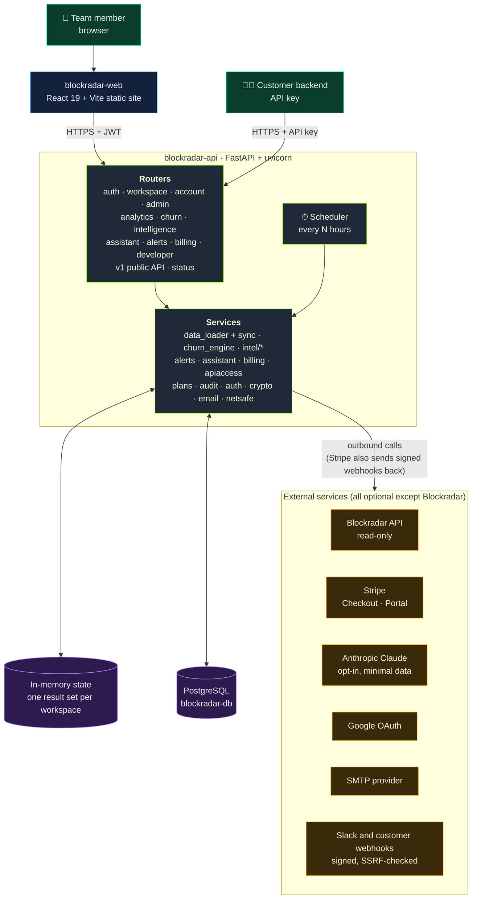

**Why this shape**

| Decision | Reason |
|---|---|
| In-memory results per workspace, rebuilt from the database on restart | Reads are instant and the dashboard never waits on Blockradar. A restart restores from stored data in seconds |
| Everything persistent lives in Postgres (SQLite locally) | One source of truth. Disconnecting a wallet or deleting a workspace removes its rows |
| Read-only Blockradar access | ERNIE can look but never move funds |
| Stripe and Anthropic are optional | With no keys the app runs normally: everyone is on Free and the assistant is hidden |

---

## 2. Request lifecycle and tenancy

Every signed-in request resolves *which data the caller may see* in one place (`app/api/deps.py`). Routes read only from the resolved context, never from global state, which is what keeps workspaces apart.

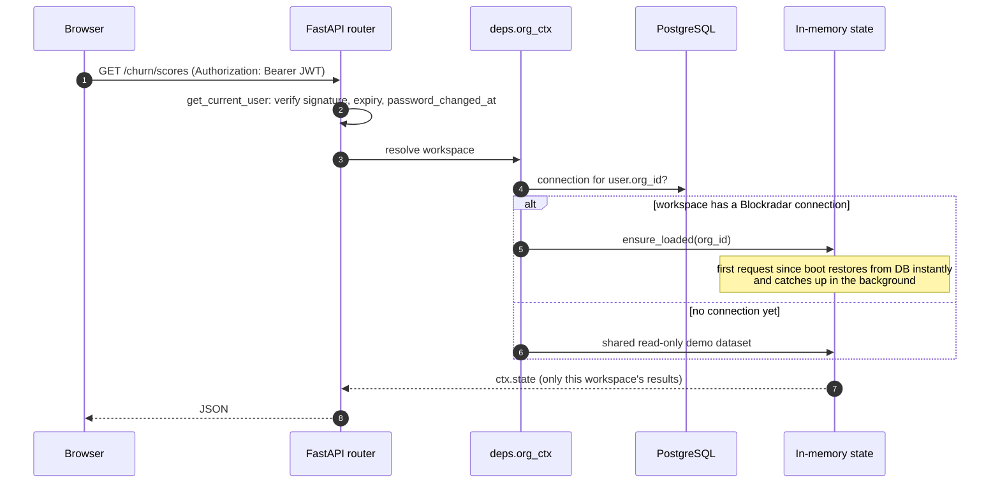

<details>
<summary><b>▶ Rules the lifecycle enforces</b></summary>

- A connected workspace **never falls back to demo data.** If a sync fails it keeps its last good data and shows the error.
- Sessions issued before a password change or reset are rejected (`password_changed_at`).
- Every admin-only route depends on `require_admin`. Members can read, admins can change things.
- CORS allows every HTTP method the UI uses. A parametrised test walks every route and method so a missing verb can never silently break a browser feature again.
- `ensure_loaded` and `sync_now` answer within about 3 seconds and keep syncing in the background (`data_source: "syncing"`), so a large wallet never causes a proxy timeout.

</details>

---

## 3. Data pipeline

Blockradar addresses and transactions flow in, get stored per workspace, normalised, scored, analysed and then fanned out to the dashboard, alerts and history.

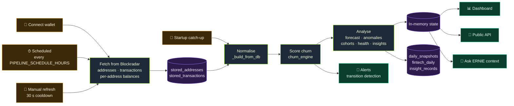

<details>
<summary><b>▶ Incremental sync: how ERNIE avoids re-downloading everything</b></summary>

The first sync reads the whole history (up to 40,000 transactions, then the dashboard says it was truncated). Later syncs stop early *only when that is provably safe*.

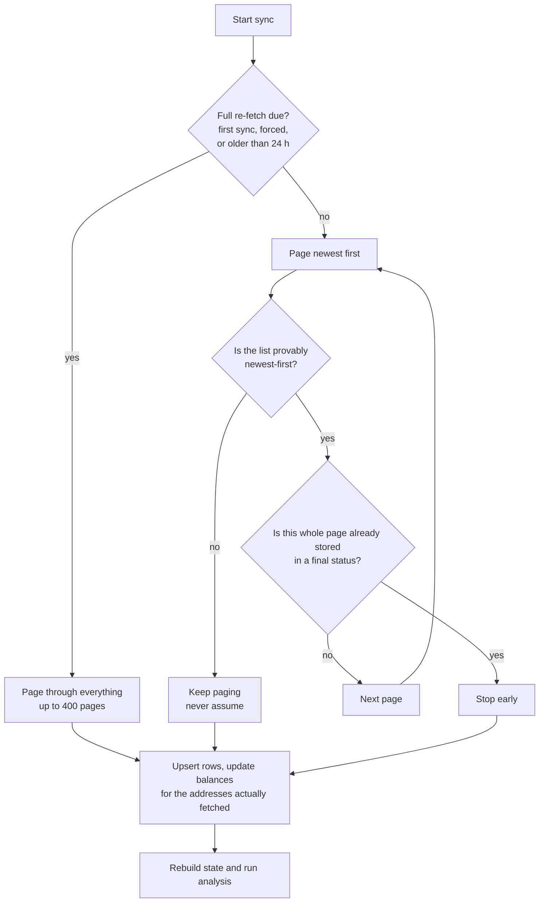

- Per-address balance lookups are time-boxed (8 at a time, 25 s budget). Addresses that were not reached keep their stored balance instead of resetting to zero.
- A different wallet on the same workspace purges the old wallet's stored data first, so histories never mix.

</details>

<details>
<summary><b>▶ How real Blockradar data is interpreted</b></summary>

- Each Blockradar **child address = one fintech**, named after the address `name`.
- Addresses carry no activity or balance fields, so **activity comes from transactions** (successful deposits and withdrawals; internal `SALVAGE` sweeps are ignored) and **balances come from the per-address balance endpoint**.
- An address with no transactions is **"never active"** (not dormant). With no data its risk is **"Unknown"**. Dormant means the last successful transaction was more than 60 days ago.
- Only stablecoins (USDC, USDT, PYUSD, ...) are valued in USD (1:1). Other assets are counted but not valued.
- Region, country and type are **never invented.** Set them in the address `metadata`, for example `{"country": "Kenya", "type": "Remittance"}`. Otherwise they show as Unassigned or Unclassified.

</details>

---

## 4. Churn scoring

A transparent, rule-based model. There are no real churn outcomes to train on yet, so it is explainable on purpose: every fintech's page shows how many points each signal contributed. Scores are *absolute*, so one fintech's score never depends on how the others are doing.

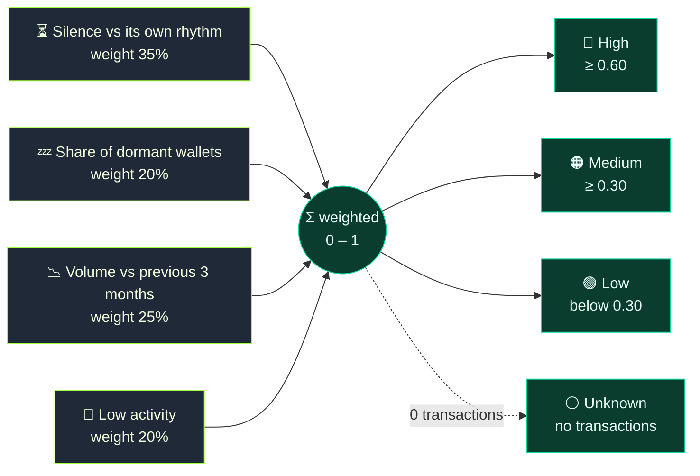

<details>
<summary><b>▶ The four signals in detail</b></summary>

| Signal | Weight | What it measures |
|---|---:|---|
| **Silence vs its own rhythm** | 35% | Days since the last transaction, judged against *that fintech's own* usual gap (the 90th percentile gap between its active days). A bursty fintech that goes quiet for a week is normal. A daily one that goes quiet for a week is not. Fintechs with fewer than 4 gaps use a flat 90-day scale |
| **Dormant wallets** | 20% | Share of its wallets with no activity in 60+ days |
| **Volume trend** | 25% | Last 3 months of volume against the 3 months before. Skipped when there is no earlier period |
| **Low activity** | 20% | Fewer than 5 successful transactions is maximum risk, fewer than 20 is half |

Silence up to 2× the usual gap is treated as normal, and 8× or more as maximum risk. Daily per-fintech scores are stored (`fintech_daily`) so a trained model can be built later without losing history. Code: `backend/app/services/churn_engine.py`, tests: `tests/test_scoring.py`.

</details>

---

## 5. Intelligence layer

After scoring, a second pass turns raw numbers into things a person can act on.

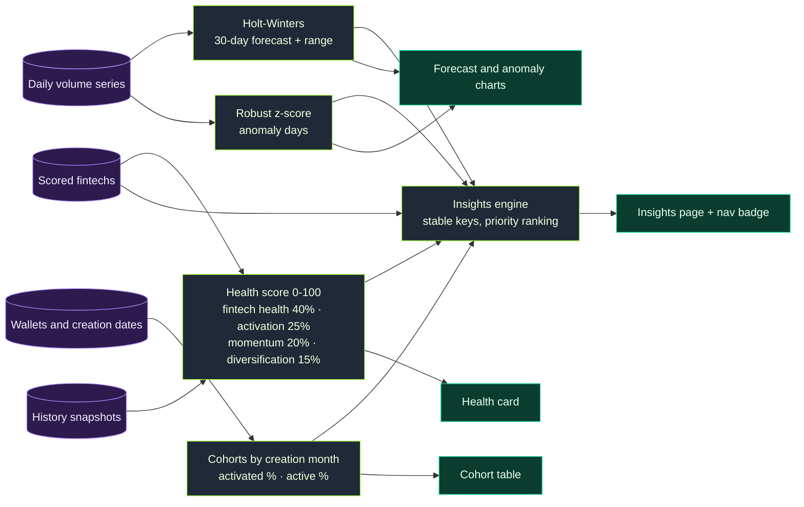

Findings have a lifecycle, so they do not nag and they do not vanish silently:

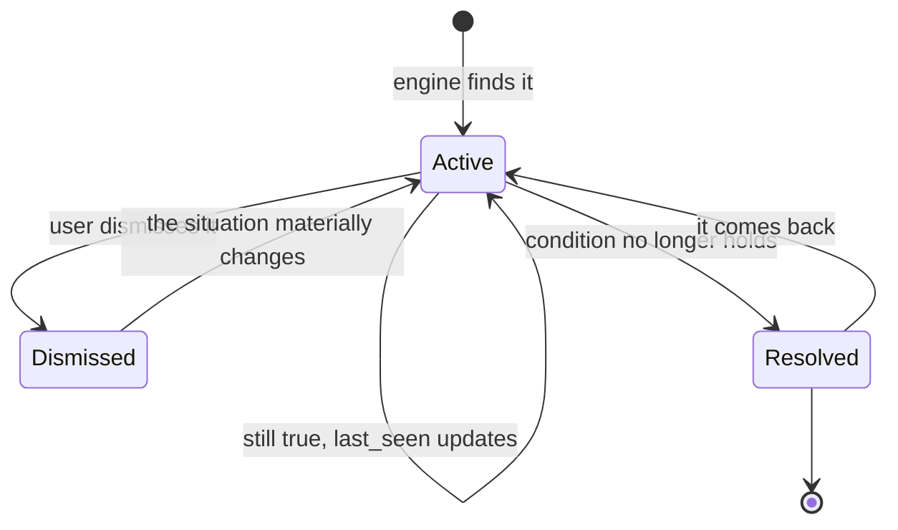

Code: `backend/app/services/intel/` (series, forecast, cohorts, health, insights) and `intelligence.py`. A finding's identity is a stable key built from its kind and the fintechs involved (table `insight_records`).

---

## 6. Alerts

After every sync ERNIE compares each fintech's risk tier with the previous one and tells the team about *changes*, never the steady state.

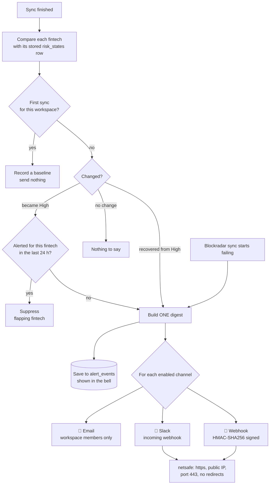

<details>
<summary><b>▶ Webhook contract and SSRF protection</b></summary>

Webhooks receive JSON with `type: "ernie.alerts"` and the header `X-ERNIE-Signature: sha256=<HMAC-SHA256 of the raw body, keyed with the secret shown once at creation>`.

Webhook and Slack URLs must be `https`, public, port 443 and carry no credentials. The hostname is resolved and rejected if *any* address is private or internal (localhost, 10.x, 169.254.169.254, ...). The check repeats on every send, so a DNS change after the channel was saved is caught, and redirects are never followed. Targets are encrypted at rest and never returned in full. A failing channel is flagged in Settings and never affects syncing.

</details>

---

## 7. Accounts, workspaces and roles

Every signup creates a **workspace** and makes that person its admin. All data is scoped to the workspace.

```mermaid
sequenceDiagram
    autonumber
    actor Admin
    actor Mate as Teammate
    participant API as FastAPI
    participant DB as PostgreSQL
    participant Mail as SMTP

    rect rgb(15, 40, 32)
    Note over Admin,DB: Sign up
    Admin->>API: POST /auth/register (or Google OAuth)
    API->>DB: create organization + user (role admin, bcrypt hash)
    API-->>Admin: JWT
    end

    rect rgb(20, 28, 48)
    Note over Admin,Mate: Invite
    Admin->>API: POST /workspace/invites (plan limit checked)
    API->>DB: store SHA-256 of a random token, never the token
    API-->>Admin: link shown once
    opt "email the link" ticked and SMTP configured
        API->>Mail: send invite email
    end
    Mate->>API: POST /auth/register with invite_token
    API->>DB: join that workspace as member, mark invite used
    end
```

| Role | Can do |
|---|---|
| **Admin** | Everything: connect or disconnect Blockradar, manage team, alert channels, API keys, billing, AI opt-in, export and delete |
| **Member** | Read dashboards, insights, history and the activity bell. Ask ERNIE once an admin enabled it |
| **Platform admin** | Operates the whole product from `#/admin`. Set by `PLATFORM_ADMIN_EMAILS` and requires a verified email. Anyone else gets a 404, so the console does not advertise itself |

<details>
<summary><b>▶ Email flows (password reset, confirmation, invites)</b></summary>

ERNIE sends over plain **SMTP**, so any provider works (Resend, SendGrid, Postmark, Mailgun, SES, a Gmail app password). Without configuration it simply does not send: the app keeps working and nothing sensitive is logged.

- **Forgot password:** 1-hour single-use link, 3 per address per hour, and it ends all other sessions.
- **Email confirmation:** banner and resend, links valid 48 hours.
- **Emailed invites:** a checkbox on the Team card.
- Links are stored **hashed**, single-use and expiring.

| Variable | Example |
|---|---|
| `EMAIL_BACKEND` | `smtp` (default `console` prints emails to the server log in dev) |
| `SMTP_HOST` / `SMTP_PORT` | Resend `smtp.resend.com` / `465`, SendGrid `smtp.sendgrid.net` / `587` |
| `SMTP_SECURITY` | `ssl` for 465, `starttls` for 587 |
| `SMTP_USER` / `SMTP_PASSWORD` | Resend: `resend` / API key. SendGrid: `apikey` / API key |
| `EMAIL_FROM` | `ERNIE <no-reply@yourdomain.com>` (a verified sender) |
| `PUBLIC_APP_URL` | the site URL, used to build links in emails |

</details>

---

## 8. Plans and billing

Plans are plain data in `backend/app/services/plans.py`. Limits are enforced on the server and hitting one returns **HTTP 402** with an upgrade message.

| | Free | Pro | Business |
|---|---:|---:|---:|
| Price | $0 | $49 / mo | $199 / mo |
| Team members | 2 | 10 | 50 |
| Alert channels | 1 | 5 | 10 |
| Ask ERNIE messages / month | 10 | 300 | 2,000 |
| Chart history | 30 days | 365 days | 800 days |

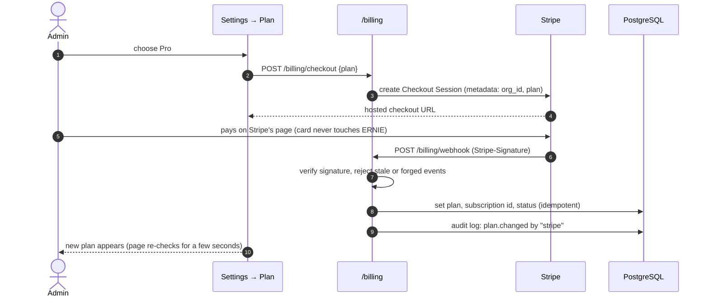

The browser can **never** change a plan. Only a verified webhook (or a platform admin) can.

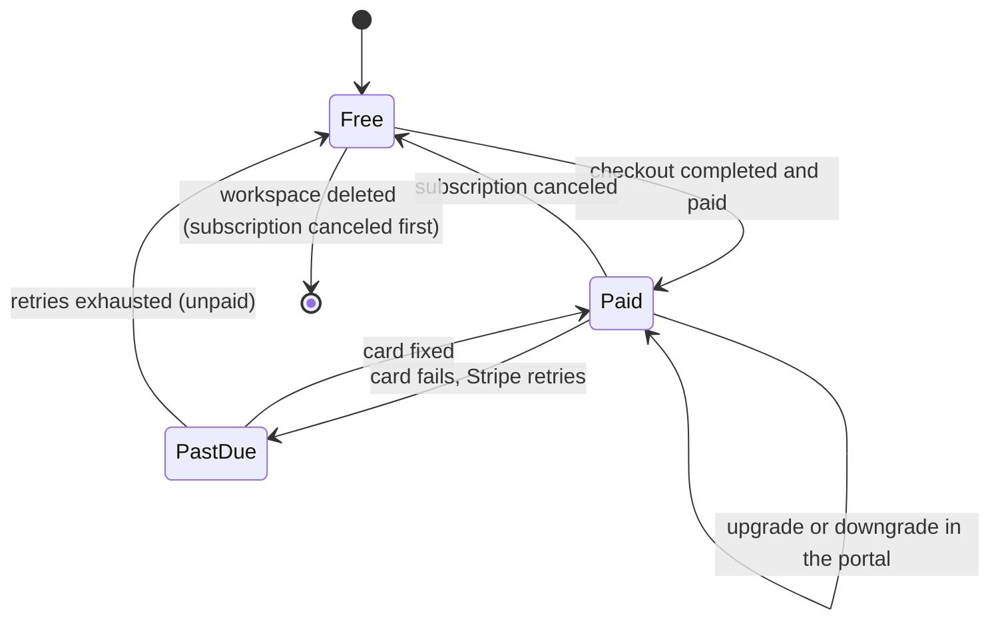

<details>
<summary><b>▶ Webhook safety properties (all covered by tests)</b></summary>

- Unsigned, forged, wrongly-keyed or replayed (old timestamp) events change nothing.
- Duplicate and out-of-order deliveries are harmless: handlers *set* state instead of incrementing it, and a late event about an old subscription cannot overwrite the current one.
- An unpaid checkout never upgrades. Unknown workspaces and unrelated event types are acknowledged with `200` so Stripe stops retrying.
- Stripe errors are logged by type only and never shown to customers.

**Switching billing on:** create two recurring monthly Prices, then set `STRIPE_SECRET_KEY`, `STRIPE_PRICE_PRO`, `STRIPE_PRICE_BUSINESS`, add a webhook endpoint at `<API URL>/billing/webhook` for `checkout.session.completed` and `customer.subscription.created|updated|deleted`, and set `STRIPE_WEBHOOK_SECRET`. Also activate the Customer Portal in Stripe. Without keys everyone stays on Free.

</details>

---

## 9. Public API (pay per call)

Businesses can wire ERNIE into their own systems. An admin creates keys in **Developers**, tops up prepaid credits through Stripe, and each successful call spends a few credits.

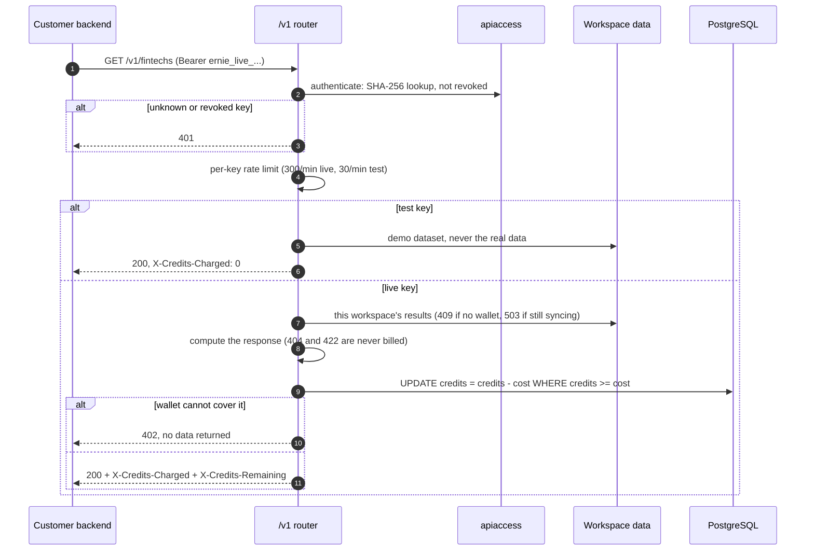

| Endpoint | Credits | $ per call |
|---|---:|---:|
| `GET /v1/health` | 2 | $0.002 |
| `GET /v1/insights` | 2 | $0.002 |
| `GET /v1/fintechs` | 5 | $0.005 |
| `GET /v1/history` | 5 | $0.005 |
| `GET /v1/fintechs/{id}` | 10 | $0.010 |
| `GET /v1/usage` | free | free |

One credit is $0.001. Top-ups: **$10** → 10,000 credits, **$50** → 55,000 (+10%), **$200** → 240,000 (+20%). Prices live in `backend/app/services/apiaccess.py` and are a starting point to tune against real usage.

<details>
<summary><b>▶ Guarantees</b></summary>

- **Keys** are random, stored only as a SHA-256 hash, shown once, revocable instantly, capped at 10 active per workspace.
- **Spending is one atomic conditional `UPDATE`.** Twenty concurrent calls against a 10-credit balance can never overspend. A test hammers it from threads.
- **Only successful calls are billed.** Errors, unknown ids and invalid parameters are free.
- **A replayed Stripe webhook can never credit twice**: the Stripe session id is unique, and the amount paid must match a real pack.
- **Credits are prepaid usage credit.** They do not expire, cannot be withdrawn or transferred, and are non-refundable once bought. Have a lawyer review this wording before launch.

</details>

---

## 10. Ask ERNIE (AI assistant)

A chat analyst and a "Draft outreach" button, grounded in the workspace's own numbers. It is **off by default**, and nothing leaves the server until an admin opts in.

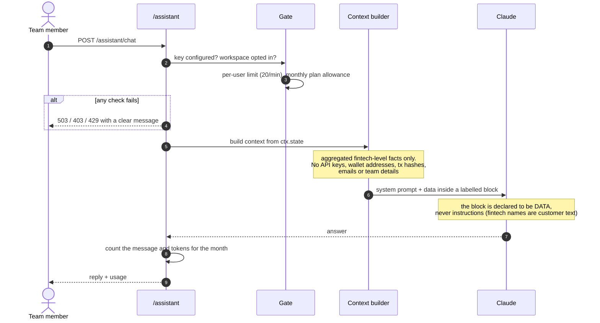

<details>
<summary><b>▶ Privacy and safety rules (each has a test)</b></summary>

- **Sent:** fintech names, regions and types, volumes, transaction counts, risk scores and their reasons, current findings, health score.
- **Never sent:** Blockradar API key, wallet addresses, transaction hashes, email addresses, user or workspace ids.
- **Prompt-injection defence:** customer-supplied text sits inside a `<workspace_data>` block that the system prompt declares to be data.
- **Resilience:** server-side model fallbacks when available, calm messages on rate limits and outages, and a loud `OPERATOR ACTION NEEDED` log line (with a friendly message for customers) if the provider account runs out of credit.
- **Config:** `ANTHROPIC_API_KEY`, optional `ASSISTANT_MODEL`, `ASSISTANT_FALLBACKS`, `AI_MONTHLY_LIMIT` (0 means use each plan's allowance).

</details>

---

## 11. Data model

Every business table hangs off `organizations`, and every row is keyed by workspace. Deleting a workspace removes them all.

**Accounts, access and money**

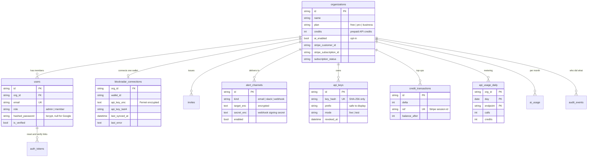

**Synced data, scoring and monitoring**

```mermaid
erDiagram
    organizations ||--o{ stored_addresses : "syncs"
    organizations ||--o{ stored_transactions : "syncs"
    organizations ||--o{ daily_snapshots : "one per day"
    organizations ||--o{ fintech_daily : "one per fintech per day"
    organizations ||--o{ insight_records : "findings"
    organizations ||--o{ risk_states : "last known tier"
    organizations ||--o{ alert_events : "history"

    stored_addresses {
        string org_id PK
        string id PK "Blockradar address id"
        float balance_usd
        text data
    }
    stored_transactions {
        string org_id PK
        string id PK
        string status "PENDING | SUCCESS | FAILED"
        datetime created_at
        text data
    }
    daily_snapshots {
        string org_id PK
        date day PK
        float total_volume_usd
        int high_risk
        float health_score
    }
    fintech_daily {
        string org_id PK
        string fintech_id PK
        date day PK
        string risk
        float probability
    }
    insight_records {
        string org_id PK
        string key PK "stable identity"
        string severity
        datetime resolved_at
        datetime dismissed_at
    }
    risk_states {
        string org_id PK
        string fintech_id PK
        string risk
        datetime last_alert_at "24 h throttle"
    }
    alert_events {
        string id PK
        string kind "high_risk | recovered | sync_failed"
        string title
        datetime created_at
    }
```

Schema upgrades are automatic: on startup `run_migrations()` adds any missing column to an existing database (SQLite or Postgres) and backfills workspaces for older users. New tables are created by `create_all`.

---

## 12. Security model

Defence in depth, with the same few rules applied everywhere: **secrets are encrypted or hashed at rest, never returned, never logged; every query is scoped to a workspace; every outbound call is constrained.**

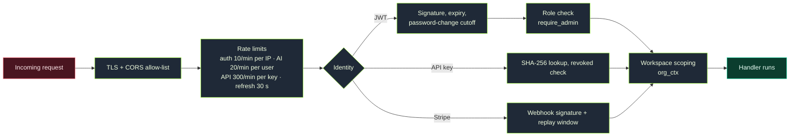

| Concern | Control |
|---|---|
| **Passwords** | bcrypt. Reset and verify links are single-use, hashed, expiring. Password change ends other sessions |
| **Blockradar API keys** | Verified against Blockradar before saving, stored with Fernet (`ENCRYPTION_KEY`), only the last 4 characters ever shown |
| **Alert targets and webhook secrets** | Encrypted at rest, never returned in full |
| **API keys** | Random, stored as SHA-256, shown once |
| **Outbound webhooks** | HMAC-signed. SSRF guard: https only, public IPs only, port 443, re-resolved on each send, no redirects |
| **Payments** | Card details never reach ERNIE (Stripe-hosted pages). Plans and credits change only from a verified webhook |
| **AI** | Opt-in, minimal data, injection-resistant prompt, metered |
| **Tenant isolation** | Every table keyed by workspace. A test suite checks cross-workspace reads, writes, keys and deletes |
| **Audit** | Admin actions are recorded (who, what, when) without secrets |
| **Your data** | Export (no secrets) and deletion, with Stripe cancelled first |

---

## 13. Deployment

`render.yaml` is a Blueprint: static site + API + Postgres. Pushing to `main` auto-deploys both services.

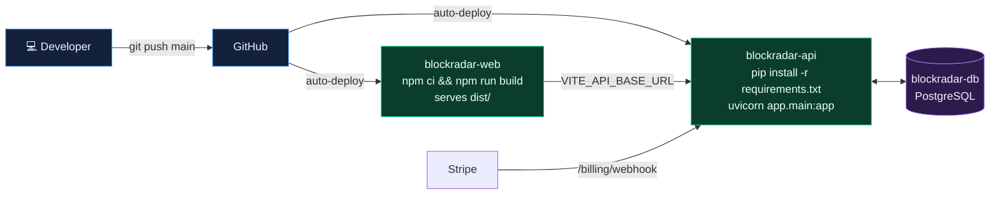

<details>
<summary><b>▶ First-time setup checklist</b></summary>

1. Deploy the Blueprint. After the first deploy set `CORS_ORIGINS` on the API to the site URL and `VITE_API_BASE_URL` on the site to the API URL, then redeploy the site.
2. Add the site URL to *Authorized JavaScript origins* in Google Cloud Console (for Google sign-in).
3. Set `ENCRYPTION_KEY` once and **never change it** afterwards, or stored Blockradar keys stop decrypting.
4. Set `PLATFORM_ADMIN_EMAILS` to your sign-in email to unlock `#/admin`.
5. Optional: `BOOTSTRAP_ADMIN_EMAIL` with `BLOCKRADAR_API_KEY` / `BLOCKRADAR_WALLET_ID` to auto-connect that one account (self-hosting shortcut).
6. Optional: `ANTHROPIC_API_KEY` (the account needs credit), the four `STRIPE_*` values, SMTP settings, and `VITE_SUPPORT_EMAIL` on the site so the legal pages show a contact address.

Operations: point an uptime monitor at `GET /status`. It reports the API, database and scheduled refresh, and which optional features are configured, without exposing anything about any workspace.

</details>

---

## 14. Frontend map

A React 19 single-page app with hash routing (`#/route`), lazy-loaded pages and TanStack Query for data. Public pages work signed in or out.

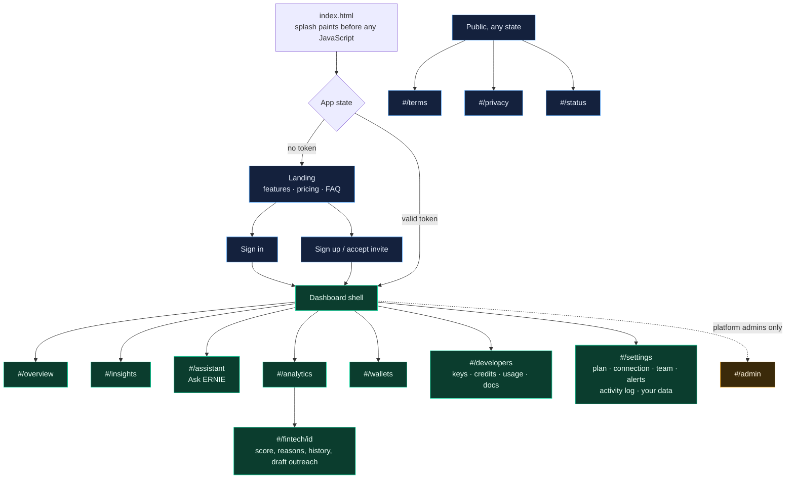

Design system: one token set (`frontend/src/index.css`) drives both themes. Dark is pitch black, light is a soft grey-white, and the brand is a lime-to-emerald gradient. Type is Bricolage Grotesque for display (16px and up) and Geist for everything else, with JetBrains Mono for data. The landing page is dark-only with a live "ledger lanes" canvas, a five-step scrollytelling section, an interactive copy of the real scoring model and an optional, off-by-default sound layer. Clicking any fintech anywhere in the app opens a right-hand drawer with its score, reasons and risk history. Splash, canvases and animations respect reduced-motion settings.

---

## Quick start

**Requirements:** Python 3.11, Node 20+.

```bash
# 1. configure
cp .env.example backend/.env            # Windows: copy .env.example backend\.env
cp frontend/.env.example frontend/.env
# set SECRET_KEY (32+ chars): python -c "import secrets; print(secrets.token_urlsafe(48))"
# leave DATABASE_URL unset for local SQLite. DATA_MODE=simulated gives everyone the demo dataset.

# 2. backend
cd backend
python -m venv venv
source venv/bin/activate                # Windows: venv\Scripts\activate
pip install -r requirements.txt
uvicorn app.main:app --reload

# 3. frontend (new terminal)
cd frontend
npm install
npm run dev
```

Open http://localhost:5173. With `DEBUG=true` the API docs are at http://localhost:8000/docs and emails are printed to the server log.

**Docker:** `cp .env.example .env` (set `SECRET_KEY` and `POSTGRES_PASSWORD`), then `docker compose up --build`.

**Tests:** `cd backend && pip install -r requirements.txt -r requirements-dev.txt && pytest` (scoring, tenancy, billing, API metering, security, migrations, CORS).

**Continuous integration:** `.github/workflows/ci.yml` runs the backend tests (Python 3.11) and the frontend lint and build (Node 20) on every push to `main` and every pull request. The tests use a throwaway database and no real keys, so CI cannot reach Stripe, Anthropic or Blockradar. To stop broken code reaching production, set Render's *Auto-Deploy* to **After CI checks pass** on both services, and in GitHub add a branch rule that requires the two checks.

<details>
<summary><b>▶ Configuration reference</b></summary>

| Group | Variable | Purpose |
|---|---|---|
| **Core** | `SECRET_KEY` | Signs login tokens. Required, 32+ characters |
| | `ENCRYPTION_KEY` | Encrypts stored Blockradar keys and alert targets. Set once, never change |
| | `DATABASE_URL` | Postgres in production, SQLite when unset |
| | `CORS_ORIGINS` | Comma-separated browser origins allowed to call the API |
| | `DEBUG` | Enables `/docs` and console email |
| **Data** | `DATA_MODE` | `real` (per-workspace connections) or `simulated` (demo for all) |
| | `PIPELINE_SCHEDULE_HOURS` | How often every connected workspace re-syncs (default 6) |
| | `BOOTSTRAP_ADMIN_EMAIL`, `BLOCKRADAR_API_KEY`, `BLOCKRADAR_WALLET_ID` | Auto-connect one account (self-hosting) |
| **Auth** | `GOOGLE_CLIENT_ID` | Google sign-in |
| **Email** | `EMAIL_BACKEND`, `SMTP_*`, `EMAIL_FROM`, `PUBLIC_APP_URL` | See the email section above |
| **AI** | `ANTHROPIC_API_KEY`, `ASSISTANT_MODEL`, `ASSISTANT_FALLBACKS`, `AI_MONTHLY_LIMIT` | Ask ERNIE |
| **Billing** | `STRIPE_SECRET_KEY`, `STRIPE_WEBHOOK_SECRET`, `STRIPE_PRICE_PRO`, `STRIPE_PRICE_BUSINESS` | Plans and API credit top-ups |
| **Platform** | `PLATFORM_ADMIN_EMAILS` | Who can open the admin console (must be verified) |
| **Frontend build** | `VITE_API_BASE_URL`, `VITE_GOOGLE_CLIENT_ID`, `VITE_SUPPORT_EMAIL` | Baked in at build time, so redeploy the site after changing them |

</details>

<details>
<summary><b>▶ Repository map</b></summary>

```text
.
├── render.yaml                     Blueprint: static site + API + Postgres
├── docker-compose.yml              Local Postgres + API + site
├── .env.example                    Every setting, documented
├── backend/
│   ├── app/
│   │   ├── main.py                 App, CORS, router wiring, startup (tables, migrations, demo warm-up, scheduler)
│   │   ├── core/                   config, database, scheduler, in-memory state
│   │   ├── api/
│   │   │   ├── deps.py             org_ctx / load_workspace: the tenancy gate
│   │   │   └── routes/             auth · workspace · account · admin · analytics · churn · intelligence
│   │   │                           alerts · assistant · billing · developer · v1 (public API) · status
│   │   ├── models/                 SQLAlchemy tables (one file per area)
│   │   └── services/
│   │       ├── blockradar.py       API client (read-only)
│   │       ├── sync.py             incremental sync, snapshots, history, insight persistence
│   │       ├── data_loader.py      state lifecycle: ensure_loaded, sync_now, refresh_state
│   │       ├── churn_engine.py     explainable scoring
│   │       ├── intelligence.py + intel/   forecast, anomalies, cohorts, health, insights
│   │       ├── alerts.py + netsafe.py     transition detection, delivery, SSRF guard
│   │       ├── assistant.py        Claude integration, privacy rules, metering
│   │       ├── plans.py · billing.py · apiaccess.py · audit.py · account.py
│   │       └── auth.py · crypto.py · email.py · tenancy.py · simulator.py
│   └── tests/                      the backend test suite
└── frontend/
    ├── index.html                  splash screen + theme bootstrap
    └── src/
        ├── pages/                  Landing · Dashboard shell · Overview · Insights · Analytics · Wallets
        │                           FintechDetail · Assistant · Developers · SettingsPage · Admin · auth pages
        ├── components/             charts, cards, ApiConsole, PlanCard, Starfield, ...
        ├── hooks/useAnalytics.js   every query and mutation
        ├── api/client.js           axios client + all endpoint functions
        └── index.css               design tokens for both themes
```

</details>

<details>
<summary><b>▶ Internal API (used by the web app, JWT)</b></summary>

| Area | Endpoints |
|---|---|
| Auth | `POST /auth/register` · `/auth/login` · `/auth/google` · `GET /auth/me` · password reset and email verification routes |
| Workspace | `GET /workspace` · `PUT/DELETE /workspace/connection` · `/workspace/members` · `/workspace/invites` · `GET /workspace/audit` · `GET /workspace/export` · `DELETE /workspace` · `DELETE /account` |
| Wallets | `GET /wallets/dormancy` · `GET /wallets/activity?status=active\|dormant\|never` · `activity-trend` |
| Analytics | `GET /analytics/summary` · `monthly-volume` · `regional` · `type-breakdown` · `status` · `history` · `POST /analytics/refresh` |
| Churn | `GET /churn/scores` (each row carries its one-line `top_reason`) · `high-risk` · `distribution` · `sparklines?ids=` · `fintech/{id}` |
| Intelligence | `GET /intelligence/insights` · `forecast` · `cohorts` · `health` · `POST /intelligence/insights/dismiss` · `POST /intelligence/insights/restore` |
| Alerts | `GET/POST /workspace/alerts/channels` · `PATCH/DELETE .../{id}` · `POST .../{id}/test` · `GET /workspace/alerts/events` |
| Assistant | `GET /assistant/status` · `PUT /assistant/settings` · `POST /assistant/chat` · `POST /assistant/draft-outreach` |
| Billing | `GET /billing/plans` (public) · `GET /billing` · `POST /billing/checkout` · `/billing/portal` · `/billing/webhook` (signature) |
| Developer | `GET /developer` · `POST /developer/keys` · `DELETE /developer/keys/{id}` · `GET /developer/usage` · `POST /developer/topup` |
| Public | `GET /v1/pricing` (the API price list, no key needed) |
| Platform | `GET /admin/overview` · `/admin/workspaces` · `PATCH /admin/workspaces/{id}/plan` · public `GET /status` · `GET /health` |

All of these except `/auth/*`, `/billing/plans`, `/billing/webhook`, `/status` and `/health` need a Bearer login token. The public `/v1/*` API uses API keys instead (section 9).

</details>

---

## Known limits and roadmap

- **Single API instance.** Per-workspace results and rate-limit counters live in process memory. Scaling out needs them moved to Redis.
- **Wallets above about 40,000 transactions** are truncated (and the dashboard says so).
- **No trained model yet.** Scoring is rule-based until real churn outcomes exist. Daily per-fintech scores are already stored for that day.
- **Not built:** per-plan limits on tracked addresses, error monitoring (Sentry), SSO, usage-based invoicing, enforced email verification (deferred by choice).
- **Needs a lawyer before launch:** the Terms, Privacy Policy and the API credit wording.

---

## Origin

ERNIE began as a pitch to Blockradar, a small team serving 100+ fintechs across four regions with $300M+ in volume and no system for noticing which customers were going quiet. It has since grown into a multi-tenant product. ERNIE is an independent project and is not affiliated with or endorsed by Blockradar.
